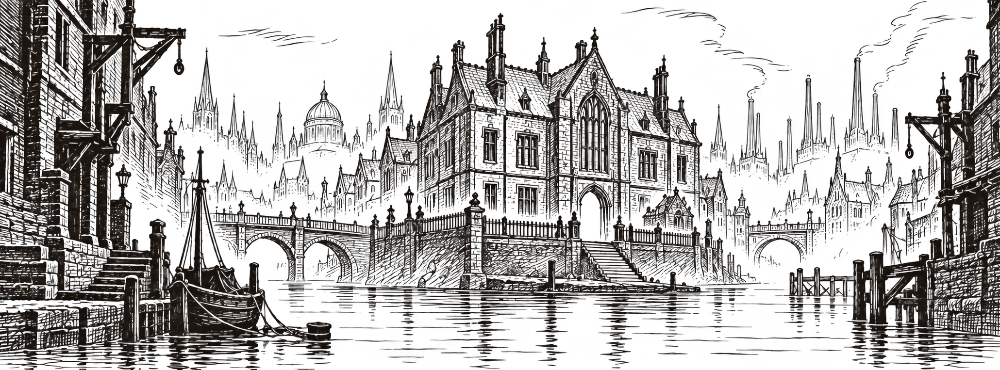

İpekyalı’da bir kapının gece yarısı açılması haber sayılmaz. Aynı kapının üç kez açılması, her seferinde başka bir yüzün görünmesi ve içerideki saatin her konuktan sonra bir saat geri gitmesi ise matbaamızın mürekkebine değer. Kızıl Kuşaklar Okulu’nun karşısındaki apartmanda oturan üç kişi, dün gece gördüklerini birbirinden habersiz anlattı. Saat konusunda anlaşamadılar. Kapı konusunda hepsi aynı şeyi söyledi: İçeri girenler vardı, çıkan yoktu.

İlk ziyaretçinin yüzünü uzun bir tül örttüğü, ikincisinin boş bir kafes taşıdığı ileri sürülüyor. Üçüncü ziyaretçi içinse tanıklarımızın kullandığı tek ortak sözcük “ıslak”. Oysa mahallede gün boyunca yağmur yağmadı. Okulun taş merdivenlerinde bu sabah gördüğümüz su izleri, sokağa doğru değil, duvara doğru ilerliyordu.

_Doskvol’da gece — gazete için hazırlanmış temsili gravür._

## Zil neden dört kez çaldı?

Okulun emekli aşçısı Nera Dalkır, bina boşaltıldığında mutfak zilinin de söküldüğünü söylüyor. “Dilin ucundaki çatlağı ben bilirim,” dedi. “Çorba pişerken bile insanın dişini kamaştırırdı. Dün gece duyduğum oydu.” Dalkır’ın ifadesine göre zil dört kez çaldı. Kendisine üç konuktan söz ettiğimizde bir süre sustu, sonra penceresini kapattı.

Binanın bugünkü kâtibi ise görüşme talebimizi kabul etmedi. Kapı aralığından uzattığı kâğıtta yalnızca “Kayıtlarımız eksiksizdir” yazıyordu. Kâğıdın arkasında, silinmeye çalışılmış bir isim seçiliyordu. Aynı ismi okulun eski mezun listesinden kontrol etmek istediğimizde, ilgili sayfanın defterden çıkarıldığını gördük.

> “Kimsenin çıkmadığını söylemedim. Çıkan kimseyi görmediğimi söyledim. Arada geçimimi sağlayacak kadar fark var.”

Bu sözler, okulun karşısında gece nöbeti tutan arabacıya ait. Arabacı adını vermek istemedi; atının adını da yayımlamamamızı özellikle rica etti.

## Kayıtlara geçmeyen bir teslimat

Yakındaki bir ciltçinin çırağı, okuldan sabaha karşı bir defter çıkarıldığını anlattı. Defterin boyunu iki eliyle gösterdi, rengini hatırlamadığını söyledi. Ardından, daha önce sormadığımız hâlde, onu kendisinin taşımadığını ekledi. Çırağın ustası görüşmemizi burada sona erdirdi.

Mahallede anlatılanlar kadar anlatılmayanlar da dikkat çekiyor. Dün akşam açık olan iki dükkân bugün kepenk indirmişti. Sokağın köşesindeki fener, yakıtı bulunduğu hâlde söndürülmüştü. Okulun zilini soran bir başka muhabirin ise bize ait olmadığı anlaşıldı. Şimdilik hangi gazeteden geldiğini bilmiyoruz.

Bu haber baskıya girerken okuldan ikinci bir açıklama geldi. İlk kâğıtla aynı el yazısıydı: “Kayıtlarımızda hiçbir eksik yoktur.” Bu kez arkasını çevirmememiz istendi.

_Editörün notu: Tanık anlatımları birbiriyle tam olarak örtüşmüyor. Üç ziyaretçinin kimliği ve defterin nereye götürüldüğü henüz doğrulanmış değil. Okurlarımızın okul kapısına isimlerini bırakmamalarını rica ediyoruz._
